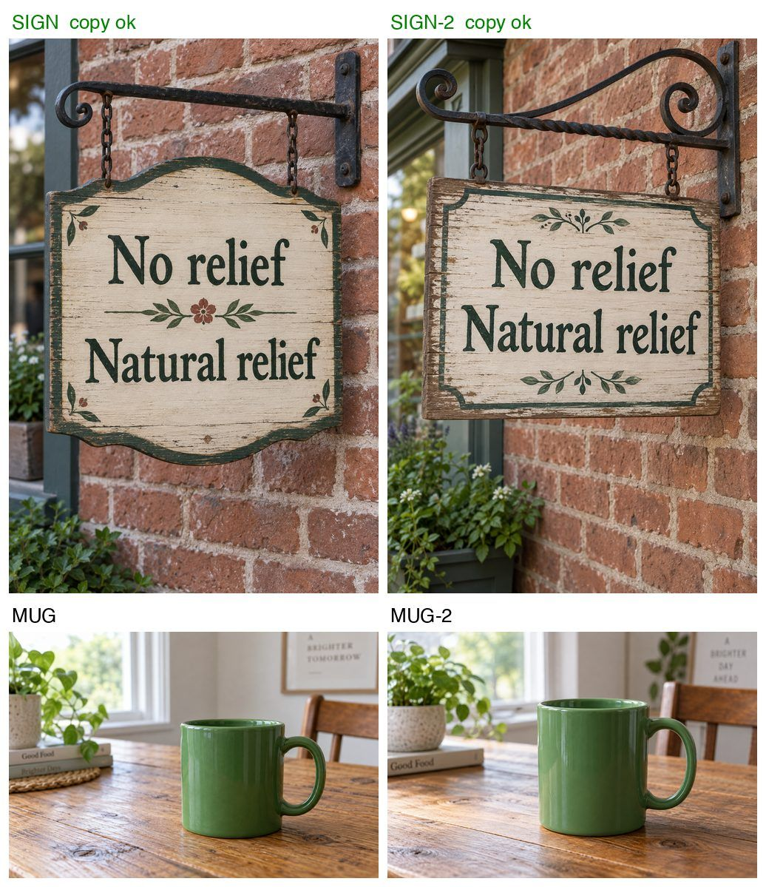

# lunagen

Batch image generation on your ChatGPT login. One request per image, no agent in between: about 2–7k tokens and 20–40 s each.



```sh
lunagen batch jobs.jsonl -d out          # 2 variants per job, auto-checked
lunagen "a green mug" -o mug.png --size 1536x1024
```

```json
{"name": "SIGN", "prompt": "A shop sign that reads 'No relief'", "size": "1024x1536", "copy": ["No relief"], "refs": ["/abs/ref.png"]}
```

- **Variants:** 2 per job by default. `"n"` per job or `--n` per run.
- **Checks:** output shape vs the asked size, and every `copy` string found in the image by local OCR (misreads get a closer second look).
- **Contact sheets:** one row per concept, flagged images framed in red, and a `REDO` / `ONE-OF` verdict per concept.
- **Safe reruns:** resumes, re-renders edited prompts, keeps every old version on `--redo`, stops cleanly at the usage limit.
- **Also:** `--dry-run` (cost and problems, renders nothing), `--redo-low`, `lunagen check`.

## Setup

macOS, Python 3 with Pillow, `codex login`, and [chatgpt-imagegen](https://github.com/leeguooooo/chatgpt-imagegen) (not included): put `chatgpt-imagegen.py` beside `lunagen.py` or set `LUNAGEN_ENGINE`.

```sh
python3 -I test_lunagen.py   # offline tests
```

Unofficial. It uses your own ChatGPT login; check OpenAI's terms before relying on it.

MIT
